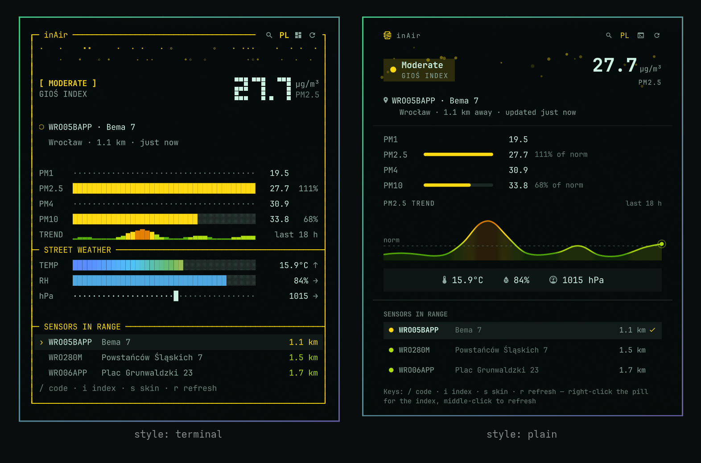
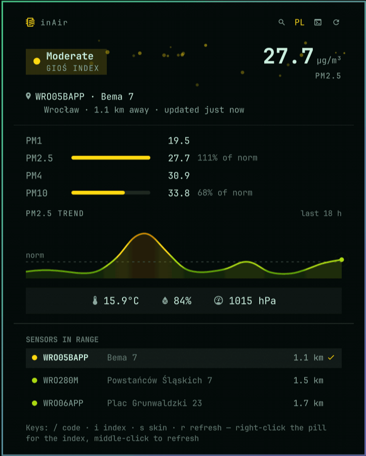

# inAir

Street-level air quality on your Omarchy bar: PM2.5 from the citizen sensors
on your street, the official monitoring station nearby, a forecast model, and
the index of the InPost parcel locker down the road, side by side.



<sub>Screenshots show a sensor in Wrocław and a made-up trend, for illustration.</sub>

> **Unofficial.** inAir is an independent hobby project. It is not made,
> endorsed, sponsored or supported by Sensor.Community, GIOŚ, Open-Meteo,
> ECMWF/Copernicus or InPost S.A., and its author has no connection with any
> of them. It only reads data they publish openly. "InPost" and "Paczkomat"
> are trademarks of InPost S.A. and appear here only to say where data comes
> from.

## Where the data comes from

inAir reads from one of four sources at a time. You choose it the first time
you open it, and switch with `1`–`4` in the panel whenever you like; the choice
is saved. Only the chosen source is asked, so only its host ever sees your
location.

| Source | What it is | Updates | Gives | Gets from you |
|---|---|---|---|---|
| **Sensor.Community** | citizen low-cost sensors on balconies and lamp posts | every 5 min | PM1*, PM2.5, PM10, temperature, humidity, pressure: the median of the nearest five sites | your coordinates, rounded to ~100 m |
| **GIOŚ** | Poland's official monitoring stations | hourly, 1–2 h behind | PM2.5, PM10 and the official Polish index from the nearest station within 30 km | nothing: inAir downloads the whole station list and picks the nearest one itself |
| **Open-Meteo** | the CAMS air quality **model**, ~11 km grid in Europe, ~45 km elsewhere | every 15 min | PM2.5 and PM10 as modelled, not measured, plus temperature, humidity and pressure from its weather forecast | your coordinates, rounded to ~100 m |
| **InPost** | the sensor on the nearest parcel locker | every few minutes | the locker's index level only (see below) | your coordinates, rounded to ~100 m |

\* PM1 comes only from sensors that measure it (SPS30).

None of them needs an account or a key.

**Outside Poland**, two of the four work: Open-Meteo everywhere on Earth, and
Sensor.Community wherever volunteers have put up sensors — dense across most of
Europe, sparse or absent in much of the Americas, Asia and Africa. GIOŚ and
InPost are Polish; InPost ignores lockers more than 10 km away. Open-Meteo is
the default because it always has an answer. Free global networks with more
coverage (OpenAQ, WAQI) all require an API key, which inAir does not ask for.

Sensor.Community is closest to the street but uses cheap sensors that
read high in fog; GIOŚ is the reference but far between and an hour or two
behind; Open-Meteo works anywhere but is a model, and inAir says so wherever it
shows it.

### InPost: index only

In October 2021 InPost started fitting air quality sensors to its Paczkomat®
lockers, as part of its *InPost Green City* programme
([press release, in Polish](https://inpost.pl/sites/default/files/docs/dla-prasy/20211020_SIEC_PACZKOMATOW_INPOST_PRZEKROCZYLA_15000.pdf)).
inAir began as a widget for exactly those sensors.

Since 7 October 2026 InPost refuses automated requests for the readings
(`inpost.pl/shipx-point-data/…` answers HTTP 403 from a Cloudflare rule).
inAir will not get around that by pretending to be a browser, and makes no
request to that endpoint. What InPost still publishes openly is each locker's
index level, so with the InPost source on, the panel shows that level
(`GOOD`, `MODERATE`…) and no numbers. The code that read the numbers is still
in the plugin, switched off, for the day InPost opens access again.

## Install

```bash
omarchy plugin add https://github.com/priard/omarchy-inair --enable --yes
```

The widget lands in the centre of the bar. Move it with
`omarchy bar move priard.inair --section right`.

### Setting up

Until it is set up the pill shows `󰵃 ⚙`. Click it, and the panel asks two
things:

1. **Where.** If the Weather widget has a location with coordinates, inAir
   offers it. Otherwise, or if you want somewhere else, type a town or a
   district (looked up by Open-Meteo's geocoder) or a Polish postcode (looked
   up by InPost's locker search), press Enter and pick the result. inAir keeps
   its own place; what you type is not stored.
2. **Which source.** Enter or Space chooses one. Each source says which host
   gets your location.

Choose **Done**, and the pill shows the source's PM2.5 within a few
seconds. Everything stays changeable later with `o`.

Upgrading from 0.8: the wizard opens once, with InPost already on and your
pinned locker kept.

### Update

```bash
omarchy plugin update priard.inair
```

This fetches the latest version from GitHub, shows what changed and asks
before applying it. Add `--yes` to skip the question, or leave out the id to
update every git-installed plugin at once. The new version is validated
before it is kept; if validation fails, the update is rolled back. The update
only fast-forwards, so it refuses to run if you have edited the plugin's files
locally. Your settings in `shell.json` are kept.

The shell reloads the plugin when its files change, but it can keep parts of
the old version cached. If the panel still looks the same after an update,
restart the shell:

```bash
omarchy-restart-shell
```

See [CHANGELOG.md](CHANGELOG.md) for what each version changed.

### Coming from InPost Air 0.3.0?

The plugin was renamed in 0.4.0, and its id changed from `priard.inpost-air`
to `priard.inair`. Remove the old one and add the new one:

```bash
omarchy plugin remove priard.inpost-air --yes
omarchy plugin add https://github.com/priard/omarchy-inair --enable --yes
```

Settings were stored under the old id. If you had changed any, set them again
with `omarchy bar set priard.inair …`.

## Usage

The pill shows PM2.5 in µg/m³, coloured by the air quality index:

| Colour | Polish index (GIOŚ) | European index (EEA) |
|---|---|---|
| green / cyan | Very good | Good |
| light green / teal | Good | Fair |
| yellow | Moderate | Moderate |
| orange / red | Sufficient | Poor |
| red / crimson | Bad | Very poor |
| maroon / purple | Very bad | Extremely poor |

The colours are the official ones, adjusted to stay readable on your theme.
Each one keeps its hue but is darkened or lightened just enough to reach a
minimum contrast against the actual bar and panel background, so GIOŚ yellow
on a light theme and its maroon on a dark one no longer disappear.

- **Left-click** opens the panel.
- **Right-click** switches between the Polish (GIOŚ) and European (EEA) index.
- **Middle-click** refreshes immediately.

Inside the panel, the header buttons and their keys:

| Button | Key | Does |
|---|---|---|
| 󰍉 | `/` | Opens the settings page with the search field focused: a **town or district**, a **postcode** (`31-042`), or, with InPost chosen, a **locker code** (`KRA80M`) to pin that locker. |
| `PL` / `EU` | `i` | Shows which index is in use; click to switch. InPost's level is always on the Polish scale. |
| 󰒓 | `o` | Places and sources: the same page as the first-run wizard, plus the index scale, the skin and the refresh interval. |
| 󰕮 / 󰆍 | `s` | Switches between the terminal and the plain skin. |
| 󰑐 | `r` | Asks every source again, now. Spins while it works. |
| | `1`–`4` | Switches to that source (1 Sensor.Community, 2 GIOŚ, 3 Open-Meteo, 4 InPost) and saves the choice. |

Hover a button for a tooltip. A switch takes effect immediately and is saved
to `shell.json`, so it survives a restart.

- **Sources.** Under the readings, one line per source, the chosen one with
  its level, PM2.5 and PM10 and how old its data is. Click one, or press its
  number, to switch to it. A source that has nothing for your place says why
  ("No Sensor.Community sensor within 10 km", "No GIOŚ station with live PM
  data within 30 km"), and the list shows what else to try.
- **In the median.** For Sensor.Community, the sites the number came from and
  how far away they are.
- With InPost shown, its **lockers in range** are listed; click one to pin it,
  "follow the nearest sensor" to go back.

### Skins

The default **terminal** skin draws the panel as a character grid: one
monospace cell per column, box-drawing for the frame, block characters for the
meters.

```
┌─ inAir ─────────────────────── ⌕ PL ▦ ↻ ─┐
│                 ∘            · ·         │
│    ∙  ·       ∘  ∘               ·  ∙    │
│ [ VERY GOOD ]                  9.7 µg/m³ │
│ GIOŚ INDEX                         PM2.5 │
│                                          │
│ ◆ Sensor.Community · median of 5 sensors │
│   1.8 km · 2 min ago                     │
│                                          │
│ PM1    ····················    3.7       │
│ PM2.5  ████████░░░░░░░░░░░░    9.7   39% │
│ PM4    ····················   12.0       │
│ PM10   ██████░░░░░░░░░░░░░░   16.0   32% │
│ TREND  █▆▇▅▂▂▃▁              last 40 min │
├─ STREET WEATHER ─────────────────────────┤
│ TEMP   █████████████░░░░░░░     17.3°C ↑ │
│ RH     ██████████████████░░        92% → │
│ hPa    ··············█·····       1031 ↓ │
│                                          │
├─ SOURCES ────────────────────────────────┤
│ › ● 1 Sensor.Community PM2.5 10 2 min ago│
│   ● 2 GIOŚ             official stations │
│   ● 3 Open-Meteo       model and weather │
│   ● 4 InPost           locker index      │
│ / find · o setup · 1-4 source · i s r    │
└──────────────────────────────────────────┘
```

In the panel itself the rows have more space between them than this text
version shows, and PM2.5 is drawn large in square pixel digits.

- **Air flow.** The two rows under the title are particles drifting past. The
  dirtier the air, the denser the drift: a few dots on a clean day, a haze
  past the norm. The animation only runs while the panel is open.
- **Meters.** The filled run is the share of the legal norm (PM2.5 against
  25 µg/m³, PM10 against 50). Past 100% the bar is full and the number tells
  the rest. PM1 and PM4 have no legal norm, so they get a dotted track.
- **Trend.** A sparkline of PM2.5 over the last hours, up to a day. Each cell
  is an average over an equal slice of time, so a night with the laptop asleep
  shows as a flat stretch, not a jump. Each cell is coloured by the index it
  stood at in its own slice of time, worked out from that slice's PM2.5 and
  PM10 on the scale in use, so a smoggy morning stays red after the air has
  cleared. Only those two values are stored, so a cell can now and then differ
  from the level the source showed at the time. The readings are kept in a
  small private file (see below), so a shell restart or a plugin update does
  not wipe the trend. The trend is kept per source and place, so it never
  mixes two streets or two sources. InPost publishes no numbers, so its trend
  is the index level itself.
- **Weather** (Sensor.Community's sensors, or Open-Meteo's forecast), in the same block cells as the meters. Temperature is a
  heat strip on a −20…40 °C scale, each cell coloured by the temperature it
  stands for, from cold blue to hot red. Humidity fills 0–100%. Pressure is a
  single block on a dotted 970–1050 hPa ruler. Each row has an arrow showing
  which way the value has been moving.

The **plain** skin shows the same content in ordinary widgets, with soft motes
drifting behind the headline instead of the particle rows; there are more of
them when the air is worse. Its counterpart to the sparkline is an area chart
of PM2.5 over the same stored history: a smooth curve whose colour follows the
index along time, a dashed line at the legal norm (25 µg/m³), a pulsing dot
for the latest reading, and, under the pointer, the value and the time it was
measured.



Each source refreshes on its own schedule: every `refreshMinutes`, but never
more often than the source itself updates. A failed refresh leaves the last
reading on screen, and a source that keeps failing waits longer between tries,
up to an hour.

## Configure

Most of it is in the panel (`o`). Settings live in the widget's entry in
`~/.config/omarchy/shell.json` and take effect on save, whether you edit the
file by hand or use `omarchy bar set`:

```bash
omarchy bar set priard.inair sources gios      # or sensorcommunity, openmeteo, inpost
omarchy bar set priard.inair index european
omarchy bar set priard.inair style plain
omarchy bar set priard.inair locker KRA80M   # pin an InPost locker
```

```json
{ "id": "priard.inair", "sources": ["gios"], "place": { "name": "Kraków", "latitude": 50.06, "longitude": 19.94 }, "setupDone": true, "index": "polish", "style": "terminal", "refreshMinutes": 5 }
```

| Key | Default | Meaning |
|---|---|---|
| `sources` | `["openmeteo"]` | The chosen source, as a one-item list (or a plain string): `sensorcommunity`, `gios`, `openmeteo` or `inpost`. A longer list (0.9 betas) keeps its first item. |
| `place` | none | Where to read: `{ name, latitude, longitude }`. Without it, the Weather widget's location. |
| `setupDone` | `false` | Whether the first-run wizard has been through. |
| `locker` | `""` | InPost locker to pin, e.g. `"KRA80M"`. Empty follows the nearest one with a sensor. |
| `index` | by source | `"polish"` for the GIOŚ scale, `"european"` for the EEA one. Unset, GIOŚ and InPost use the Polish scale and the others the EEA one. |
| `style` | `"terminal"` | `"terminal"` for the character-grid skin, `"plain"` for ordinary widgets. |
| `refreshMinutes` | `5` | How often to refresh, clamped to 1–60; no source is asked more often than it updates. |

`resolvedCode` and `resolvedId` may remain from 0.8; 0.9 no longer uses them.

## What it talks to, and what it writes

Public endpoints only. No account, no API key, no credential of any kind:

| Endpoint | When | What for | Receives |
|---|---|---|---|
| `GET data.sensor.community/airrohr/v1/filter/box=…` | every 5 min or more | the sensors around your place | a box around your place, rounded to ~100 m |
| `GET api.gios.gov.pl/pjp-api/v1/rest/station/findAll` | once a session and on a new place | all GIOŚ stations, to pick the nearest here | nothing |
| `GET api.gios.gov.pl/pjp-api/v1/rest/station/sensors/<id>`, `data/getData/<id>`, `aqindex/getIndex/<id>` | every 20 min or more | that station's sensors, readings and index | the station's id |
| `GET air-quality-api.open-meteo.com/v1/air-quality?…` | every 15 min or more | modelled PM for your place | your place, rounded to ~100 m |
| `GET api.open-meteo.com/v1/forecast?…` | right after each of the above | temperature, humidity, pressure | your place, rounded to ~100 m |
| `GET api-shipx-pl.easypack24.net/v1/points?relative_point=…` | when InPost is on and finds its locker | the nearest locker with a sensor | your place, rounded to ~100 m |
| `GET api-shipx-pl.easypack24.net/v1/points/<code>` | every `refreshMinutes` with InPost on | that locker's index level | the locker's code |
| `GET api-shipx-pl.easypack24.net/v1/points?relative_post_code=…` | when you search a postcode | a point near that postcode, to stand for it | the postcode |
| `GET geocoding-api.open-meteo.com/v1/search?name=…` | when you search a place name | matching places | what you typed |

Only the source you choose is asked anything. Nothing else leaves the
machine, and inAir never looks up your location from your IP address.
Requests identify themselves with the user agent `omarchy-inair`.

Every request goes through `bin/inair-fetch`. It knows only the hosts above,
builds each URL itself from a fixed template, only accepts arguments that
match fixed patterns (a typed place name leaves as percent-encoded bytes),
refuses redirects and proxies, caps the size of every response, and kills the
request after a deadline. What a request is about (coordinates, a postcode, a
place name, a locker code) never appears on a command line,
where any user of the machine could read it in `/proc`: the widget hands it to
the helper on stdin, and the helper hands the URL to curl the same way.

Files:

| Path | Access | What |
|---|---|---|
| `~/.config/omarchy/shell.json` | its own entry only | settings, including the place you chose (name and coordinates) |
| `~/.local/state/omarchy/settings/weather.json` | read only | Omarchy's location, never modified |
| `~/.local/state/priard.inair/history.json` | read and write | the trend: for the four source-and-place pairs used most recently, a key such as `sc:50.06,19.94`, `gios:400` or `inpost:KRA80M`, and readings from the last 24 hours |

The trend file is the only file the plugin creates. It is small (at most four
keys of 320 readings each, capped at 256 KiB) and drops anything older than a
day on every write; when a fifth comes along, the one read least recently
goes. Because its keys say roughly where you are and where you looked, it is
private from the moment it is created: mode 0600 in a 0700
directory. All access goes through `bin/inair-history`, which refuses a
symlink, a FIFO, a file someone else owns or one that is too large, and writes
through a fresh temporary file that is renamed over the old one. Readings and
keys travel to it on stdin, never on the command line.

## Remove

```bash
omarchy plugin remove priard.inair
```

That deletes the plugin and its bar entry, including its settings block in
`~/.config/omarchy/shell.json`. There is no daemon, cache or system
configuration to clean up, and no privileges were granted, so none need
revoking.

One file survives removal: the trend history,
`~/.local/state/priard.inair/history.json`, which holds up to four
source-and-place keys and a day of readings for each. Delete it, and its directory, yourself if you want no trace
left:

```bash
rm ~/.local/state/priard.inair/history.json
rmdir ~/.local/state/priard.inair
```

## Credit and data licences

- **Sensor.Community** data is published under the
  [Open Data Commons DbCL 1.0](https://opendatacommons.org/licenses/dbcl/1-0/);
  the sensors belong to the volunteers who run them.
- **GIOŚ**: Źródło danych: Główny Inspektorat Ochrony Środowiska
  ([API](https://powietrze.gios.gov.pl/pjp/content/api)). Data are current and
  unverified.
- **Open-Meteo**: air quality from the Copernicus Atmosphere Monitoring Service
  (CAMS), served by [Open-Meteo](https://open-meteo.com/) under
  [CC BY 4.0](https://creativecommons.org/licenses/by/4.0/).
- **InPost**: the locker sensors and their index belong to InPost; the
  endpoints were mapped by [CyberDeer's InPost-Air](https://github.com/CyberDeer/InPost-Air)
  Home Assistant integration.
- Index thresholds from [GIOŚ](https://powietrze.gios.gov.pl/pjp/content/health_informations)
  and the [EEA](https://www.eea.europa.eu/themes/air/air-quality-index).

The panel names the sources you have on in its footer.

## License

MIT. See [LICENSE](LICENSE).
